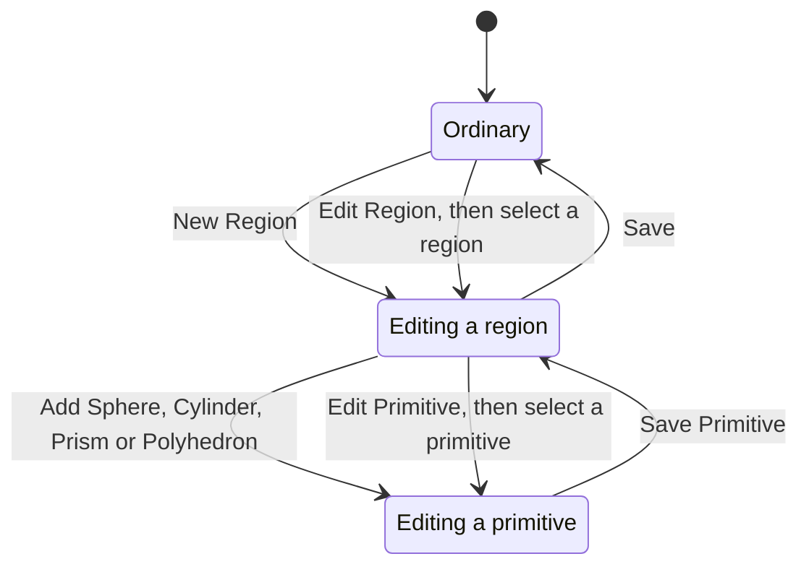

# In-game region editor

All mod key bindings start unbound, including **Open Mod Menu** and **Mark Player Position**. The menu key opens the screen for the player's current editing state. A region draft can be new or loaded from the save. In both cases the player uses the same region editor.

## States and menus

In the ordinary state, **New Region** opens the region editor with a new draft. **Edit Region** opens a region picker. Selecting a path loads that region into the same editor.

Menus place two controls per row, from left to right. Text fields take the same width and height as buttons, with the field name above the box. On shorter screens, the arrows page through complete rows and preserve entered values.

The region editor contains **Save**, **Properties**, **Edit Primitive**, **Add Sphere**, **Add Cylinder**, **Add Prism**, **Add Polyhedron** and a text field for the Boolean expression. **Properties** opens the region's parent, case-sensitive identifier, localized plain name and optional hint presentation for editing. Authors can turn the region's own hints on or off, supply rich components and set or clear its animation and relative position overrides. The expression uses the zero-based indices of the draft's primitives, for example `0 & !1`. [Region properties and paths](storage-format.md#dimension-files-and-region-paths) · [Hint presentation](hint-presentation.md) · [Expression syntax](storage-format.md#region-predicates)

Selecting an **Add** button closes the menu and starts marking that primitive in the world. **Edit Primitive** first opens a picker showing each primitive's index and type. Selecting one enters the same primitive editor with its saved geometry. While editing a primitive, the menu hides the four **Add** buttons and **Edit Primitive**, and shows **Save Primitive**, the ordered point list and the controls for that primitive's parameters. The author must save the current primitive before saving the whole region.

## Editing properties and settings

**Back** and **Esc** save global preferences to the client, world hint settings to the world, and region properties to the open draft. The region editor's **Save** commits the complete draft to the world. Opening a picker or changing pages preserves the fields you have entered. An invalid value keeps the form open for correction.

In **Properties**, use **Browse** beside the parent path to navigate the dimension tree, then choose **Use this region as parent**. The dimension root is selectable. The picker excludes the edited region and its descendants. You can also type the path directly.

Choose **+ Add language** to pick a language by name or code. Each translation gets its own field and a **− Remove** button. An empty plain name is a valid translation. **Rich text** provides separate entries for the optional fallback component and localized Java Edition text components.

**HUD X** and **HUD Y** each accept a number between 0 and 1. **Animation** opens the effect picker. **Animation parameters** shows the settings for the selected effect. [Position, animation and inheritance](hint-presentation.md#position-and-animation)

## World outlines

In the ordinary menu, open **Global Settings**, turn on **Show primitive faces and outlines**, and press **Back** or **Esc**. The top-level client preference `showPrimitiveOutlines` defaults to `false` and applies across saves and servers. It works independently of automatic hints. Every primitive in the current dimension gets translucent cyan faces and cyan outlines, including unreferenced primitives and those belonging to silenced regions. Opaque terrain hides the faces behind it. Lines within viewing distance remain visible through terrain.

While creating or editing a region, its draft appears in gold. Editing an existing primitive replaces its saved outline in the preview. Marking, changing coordinates, applying a face edit or saving a primitive updates the preview before the region is written to disk. Crosses identify the current marks. With one mark on a new sphere or cylinder, a pale gold outline previews the measurement to the targeted block, or to the player's floored position when aiming into open space. A prism shows guides to its next prospective vertex. A polyhedron shows its marks and the edges of the faces entered so far.

Sphere and cylinder curves use the square root of the stored squared radius for display. The sphere surface is filled, and its outline consists of three great circles centered on the sphere, parallel to the XY, XZ and YZ planes. Cylinders and prisms have filled side walls and a cap at each finite height endpoint. Prism caps follow the footprint's crossing parity, including holes and self-intersections. With `insideAtInfinity` enabled, the cap fills the exterior and any selected hole interiors. At unbounded height the sides extend through the view. The horizontal guide at camera height is drawn as a line. A polyhedron displays each indexed triangular face from either side, with a single outline for each shared edge.

## Marking and editing points

While editing a primitive in the world, **Mark Player Position** appends the player's coordinates, floored on each axis. Right-clicking a block appends the integer coordinates of the clicked block itself. Both inputs record all three coordinates, including Y for cylinder and prism marks.

Reopening the menu shows the marks in capture order. Select a point to change its XYZ coordinates or use **Delete** to remove it. Closing the menu to mark more points keeps the current draft. For a sphere or cylinder with two marks, either marking input sends a warning to the player's chat on a third attempt and leaves the two marks intact. Prisms and polyhedra have no editor-imposed point limit.

| Primitive | How the points define the geometry | Other parameters in the editor |
| --- | --- | --- |
| Sphere | For a new sphere, point 0 is the center and point 1 is on the surface. Store the center and `radiusSquared = Δx² + Δy² + Δz²`. | |
| Cylinder | For a new cylinder, point 0 is on the axis and point 1 is on the lateral surface. Store the center in XZ and `radiusSquared = Δx² + Δz²`. | Inclusive Y range or `"unbounded"`. |
| Prism | Store the XZ coordinates in marking order. The last vertex connects to the first. Repeated vertices can describe a return trip along a bridge. | Inclusive Y range or `"unbounded"`, and `insideAtInfinity` for the footprint. |
| Polyhedron | Store XYZ vertices in marking order. Define each triangular face by three point indices starting at 0. | Face list and `insideAtInfinity` for the solid. |

For example, marks `(10, 64, 20)` and `(13, 80, 24)` give a sphere squared radius of `281` and a cylinder squared radius of `25`. The point list shows both Y values in either editor. The cylinder's height is set separately.

A polyhedron vertex can be deleted once all faces that use it have been removed. If a face still references it, the deletion is refused. After deleting an unused vertex, later vertices move down one index and surviving face references follow them. Editing a vertex's coordinates in place preserves its index.

## Reopening saved geometry

| Primitive | Marks shown when reopened |
| --- | --- |
| Sphere | Show just the saved XYZ center. Retain the stored squared radius for a center-only edit. A new second mark supplies a replacement radius measurement. |
| Cylinder | Show just the axis center, using its saved XZ coordinates and the display Y described below. Retain the stored squared radius until a new second mark supplies a replacement measurement. |
| Prism | Restore each saved XZ vertex in order, using the display Y for every row. |
| Polyhedron | Restore the saved XYZ vertices and their indexed faces. |

For a saved cylinder or prism with a finite height range, the display Y is the lower endpoint. With `"unbounded"` height, use the player's floored Y when opening that primitive. For instance, the example cylinder with height `[60, 90]` reopens with a single mark at `(10, 60, 20)` and squared radius `25`. With unbounded height and a player at `y = 70.8`, that mark appears at `(10, 70, 20)`.

## Saving

When the player clicks **Save Primitive** for a polyhedron, check which marked vertices are referenced by its triangle faces. If any are unused, show a warning and let the player choose how to finish saving the primitive.

| Choice | Result in the region draft |
| --- | --- |
| **Keep Unused Points** | Save the full vertex list in its current order, including all unused points. Every face keeps its indices. |
| **Delete Unused Points** | Remove all unused vertices, preserve the order of the remaining vertices, and remap each face index to the same geometric point. |

For example, suppose a polyhedron has five points and only point 1 is unused. Keeping it preserves face `[0, 2, 4]`. Deleting it moves old vertices 0, 2, 3 and 4 to indices 0, 1, 2 and 3, so the same face becomes `[0, 1, 3]`. If every vertex is used, **Save Primitive** proceeds directly.

A successful **Save Primitive** applies the geometry to the region draft and returns to the region editor. A new primitive takes the next index. Editing an existing primitive replaces the entry at its original index, so every occurrence of that index in the expression uses the edit. The stored squared radius must fit in an unsigned 64-bit integer. If a pair of marks exceeds that range, report it and keep the primitive open for correction. The existing face and geometry rules apply to the editor's output. [Geometry editing rules](storage-format.md#geometry-editing)

**Save** in the region editor commits the complete region to the authoritative world save and returns the player to the ordinary state on success. The region must have a valid parent and identifier, a fallback name (which may be empty), and a valid expression over its primitive array. The saved AABB must cover the committed predicate. Unreferenced primitives can remain in the array. [World save operations](commands.md#world-save-commands)
